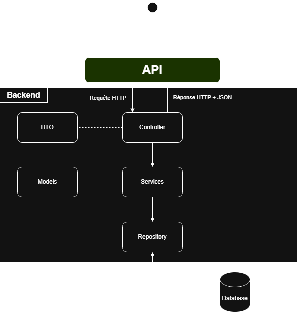

# Exercice 1 

## Schéma de l'architecture.

Tout d'abord, afin d'effectuer un système pour avoir une gestion de tâches en équipe, j'ai choisi d'utiliser une architecture en couches permettant de définir simplement les responsabilités du système.

Voici le schéma de l'architecture ci-joint :



Ici, nous nous retrouvons avec trois couches principales au sein de notre backend :

- **Controller** : C'est la couche servant d'entrée à notre API pour recevoir les requêtes et permettant les renvois de réponses. Nous pouvons également utiliser des DTO en entrée et des DTO de sortie pour cibler ce dont on a besoin et ce qu'on doit renvoyer également au client.

- **Services** : C'est la couche qui effectue les traitements. C'est ici que se trouve l'entièreté de la logique métier.

- **Repository** : Cette couche permet de gérer la lecture et la persistance des données.

De plus, nous avons un composant externe qui est la base de données. Ici par exemple, nous pouvons utiliser SQLite.

## Listes des routes de l'API.

Afin de répondre à l'ensemble des fonctions attendus, voici la liste des routes API.

```text
GET /tasks -> Liste de toutes les tâches.

GET /tasks?status=IN_PROGRESS -> Liste de toutes les tâches en cours.

GET /tasks?status=DONE -> Liste de toutes les tâches terminées.

POST /tasks -> Créer une nouvelle tâche.

PATCH /tasks/{id} -> permet d'éditer une tâche sur les variables choisis. Ici, mettre qu'une tâche est fini, ou affecter un utilisateur sur la tâche. 

DELETE /tasks/{id} -> supprimer une tâche.
```

## Schéma de base de données. 

Désormais, pour correspondre aux fonctions attendus, voici le schéma de la base de donnée suivant : 



Bien évidemment, les id de chaque table sont des clés primaire. Ici, j'ai fais le choix d'avoir seulement que deux tables, mais il est tout à fait possible d'avoir une troisième table permettant d'avoir uniquement les deux clés étrangères. Cependant je ne trouvais pas cela pertinant pour cet exercice. 

Il est a noté également que la table User peut être élargis avec un email, et d'autres attributs. Le password de cette table est hashé. 

Pour le #id_owner c'est la clé étrangère correspondant à l'id de l'utilisateur. 

Pour les cardinalités, cela peut être 1..n, ou n..n en fonction des besoins (par exemple si une tâche peut être attribué à plusieurs personnes.).

