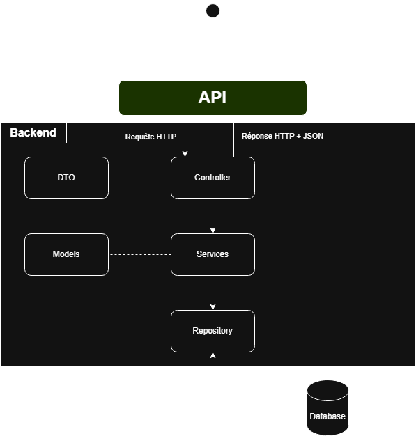

# Exercice 1 

## Schéma de l'architecture.

Tout d'abord, afin d'effectuer un système pour avoir une gestion de tâches en équipe, j'ai choisi d'utiliser une architecture en couches permettant de définir simplement les responsabilités du système.

Voici le schéma de l'architecture ci-joint :

Ici, nous nous retrouvons avec trois couches principales au sein de notre backend :

- **Controller** : C'est la couche servant d'entrée à notre API pour recevoir les requêtes et permettant les renvois de réponses. Nous pouvons également utiliser des DTO en entrée et des DTO de sortie pour cibler ce dont on a besoin et ce qu'on doit renvoyer également au client.

- **Services** : C'est la couche qui effectue les traitements. C'est ici que se trouve l'entièreté de la logique métier.

- **Repository** : Cette couche permet de gérer la lecture et la persistance des données.

De plus, nous avons un composant externe qui est la base de données. Ici par exemple, nous pouvons utiliser SQLite.