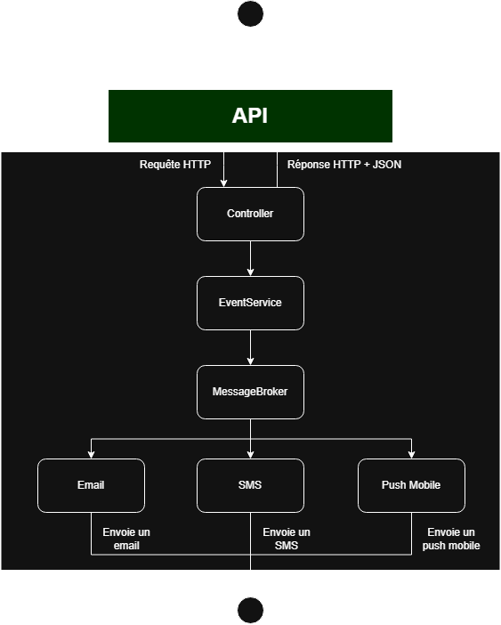
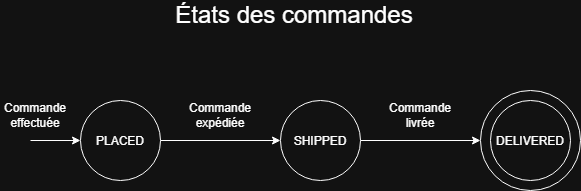

# Exercice 3 

## Choix d'architecture

Pour aborder cet exercice, j'ai tout d'abord commencé par réfléchir à une architecture qui pourrait être adaptée au projet. Au premier abord, je savais que le design pattern Publish/Subscribe était intéressant pour permettre l'envoi de notifications aux utilisateurs.

Afin d'organiser l'architecture autour de ce design pattern, j'ai d'abord réfléchi aux architectures que je connaissais et à celles qui seraient les plus adaptées.

API REST : je trouvais que l'utilisation d'une API REST seule n'était pas suffisante pour gérer la distribution asynchrone des événements et des notifications aux utilisateurs.

Architecture hexagonale : je pense que cette architecture aurait pu être intéressante pour isoler le cœur métier des services externes de notification. Cependant, l'architecture hexagonale me semble davantage adaptée à un projet plus complet, dans lequel les règles métier sont susceptibles d'évoluer. Je pense donc qu'elle serait trop complexe pour les attentes de cet exercice.

N'étant pas satisfait de ces deux architectures, j'ai recherché une architecture qui pourrait mieux correspondre au pattern Publish/Subscribe. C'est ainsi que j'ai trouvé l'Event-Driven Architecture, qui permet notamment de mettre en place un mécanisme de distribution des événements.

Cette réflexion m'a conduit à proposer l'architecture suivante :

Dans cette architecture, nous avons une couche Controller qui reçoit les requêtes HTTP et transmet les informations au service concerné.

L'EventService applique les règles métier nécessaires avant de publier un événement auprès du MessageBroker.

Le MessageBroker se charge ensuite de distribuer cet événement aux services de notification concernés (Email, SMS et Push Mobile), qui assurent l'envoi des notifications aux utilisateurs.

Afin de suivre au mieux les états qu'une commande peut avoir j'ai défini cet automate : 

Une commande ne peut se trouver que dans un seul état à la fois et ne peut passer à un autre état que lorsqu'un événement spécifique se produit.

Dans cet automate, une commande passée ne peut pas directement passer à l'état "livrée" sans être passée par l'état "expédiée".

## Liste de questions

- Il y a t-il des contraintes particuliers pour les états des commandes ? (Une commande passée, peut-il passer à livrée sans passer par expédiée) 

- Quels acteurs (livreur, client, organisme, ...) peuvent impacter le changement d'état d'une commande (expédiée, livrée) ? 

- Les notifications possibles sont-ils un choix pour un seul canal d'envoie. Ou l'ensemble des canaux peuvent être effectués. 

- Le délai d'émission d'une notification doit-il effectué instannément après le changement d'un état de commande ou d'une promotion ? 

- En cas d'erreur d'envoi de notification, doit-il réessayer dans l'immédiat, après un certains délai, ou ne jamais réessayer ?

- L'activation notification sur chaque canal est-il une décision d'un utilisateur ou déjà fixé ?

- Pour les produits récemment consulté, combien de temps sont-il conservé pour envoyer les notifications de promotion ? 
