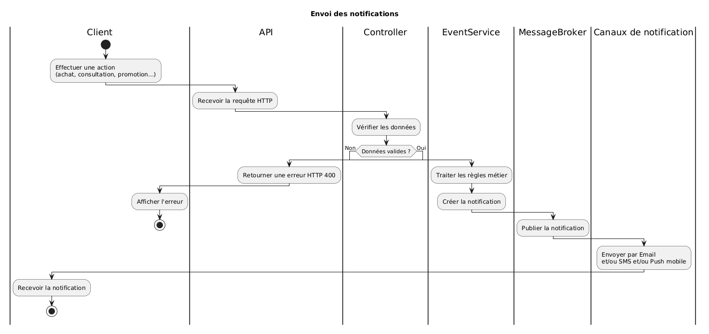
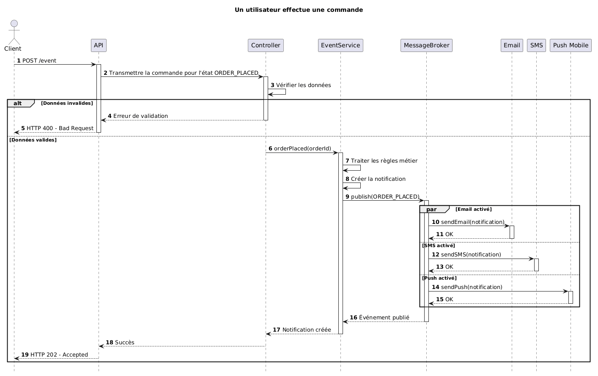

# Exercice 3 

## Choix d'architecture

### Diagramme de l'architecture

Pour aborder cet exercice, j'ai tout d'abord commencé par réfléchir à une architecture qui pourrait être adaptée au projet. Au premier abord, je savais que le design pattern Publish/Subscribe était intéressant pour permettre l'envoi de notifications aux utilisateurs.

Afin d'organiser l'architecture autour de ce design pattern, j'ai d'abord réfléchi aux architectures que je connaissais et à celles qui seraient les plus adaptées.

API REST : je trouvais que l'utilisation d'une API REST seule n'était pas suffisante pour gérer la distribution asynchrone des événements et des notifications aux utilisateurs.

Architecture hexagonale : je pense que cette architecture aurait pu être intéressante pour isoler le cœur métier des services externes de notification. Cependant, l'architecture hexagonale me semble davantage adaptée à un projet plus complet, dans lequel les règles métier sont susceptibles d'évoluer. Je pense donc qu'elle serait trop complexe pour les attentes de cet exercice.

N'étant pas satisfait de ces deux architectures, j'ai recherché une architecture qui pourrait mieux correspondre au pattern Publish/Subscribe. C'est ainsi que j'ai trouvé l'Event-Driven Architecture, qui permet notamment de mettre en place un mécanisme de distribution des événements.

Cette réflexion m'a conduit à proposer l'architecture suivante :


Dans cette architecture, nous avons une couche Controller qui reçoit les requêtes HTTP et transmet les informations au service concerné.

L'EventService applique les règles métier nécessaires avant de publier un événement auprès du MessageBroker.

Le MessageBroker se charge ensuite de distribuer cet événement aux services de notification concernés (Email, SMS et Push Mobile), qui assurent l'envoi des notifications aux utilisateurs.

### Automate des états d'une commande

Afin de suivre au mieux les états qu'une commande peut avoir j'ai défini cet automate : 


Une commande ne peut se trouver que dans un seul état à la fois et ne peut passer à un autre état que lorsqu'un événement spécifique se produit.

Dans cet automate, une commande passée ne peut pas directement passer à l'état "livrée" sans être passée par l'état "expédiée".

### Diagramme d'activité du fonctionnement d'une notification

Afin de suivre le fonctionnement d'une notification, j'ai fais ce diagramme d'activité ci-joint : 



Tout d'abord, concernant le Client, nous allons poser l'hypothèse qu'il effectue simplement un appel API pour signaler un événement (suite à la réponse à la question 2 reçu par mail). 

L'API reçoit la requête HTTP et la transmet au Controller, qui se charge de vérifier la validité des données reçues.

Deux cas sont alors possibles :

- Si les données sont invalides, le Controller renvoie directement une réponse HTTP avec le code 400 au client.

- Si les données sont valides, le Controller les transmet à l'EventService, qui applique les règles métier nécessaires avant de créer la notification adaptée. Celle-ci est ensuite publiée auprès du MessageBroker, qui se charge de la distribuer aux différents services de notification.

L'envoi des notifications dépend des préférences de l'utilisateur et doit respecter les règles suivantes (suite à la réponse à la question 6 reçue par mail) :

- Notification de commande toujours envoyées sur un canal minimum.

- Les promotions demandent le consentement explicite.

Dans le cadre de cet exercice, la gestion des préférences utilisateur ne sera pas implémentée dans le prototype.

### Diagramme de séquence pour une commande passée

Enfin, afin d'obtenir une vue globale du fonctionnement du système lors du passage d'une commande, j'ai réalisé le diagramme de séquence suivant :



Tout d'abord, l'API reçoit un événement indiquant qu'une commande a été passée (ORDER_PLACED).

La suite du traitement reste identique au fonctionnement présenté dans les diagrammes précédents.

Concernant l'envoi des notifications, en cas d'échec, plusieurs tentatives seront effectuées avant de considérer l'envoi comme définitivement échoué (suite à la réponse à la question 5 reçue par mail).

## Liste de questions

- Il y a t-il des contraintes particuliers pour les états des commandes ? (Une commande passée, peut-il passer à livrée sans passer par expédiée)

Réponse : 

```
Considérons un cycle linéaire : Passé => Expédié => Livré.
Une commande ne peut pas sauter d'étape. Nous ne considérons pas non plus de compensation dans le cadre de l'exercice.

Rejeter une transition invalide est un plus, mais ce n’est pas obligatoire. L’annulation et le retour sont hors périmètre.
```

- Quels acteurs (livreur, client, organisme, ...) peuvent impacter le changement d'état d'une commande (expédiée, livrée) ?

Réponse :

```
Très pertinent, cependant c'est hors périmètre. Nous allons considérer que les changements d'état arrivent sous forme d'event, par exemple un simple appel HTTP venant du système de commande ou du transporteur. Inutile de modéliser le livreur ou le client.
```

- Les notifications possibles sont-ils un choix pour un seul canal d'envoie. Ou l'ensemble des canaux peuvent être effectués.

Réponse :

```
Un même event peut partir sur plusieurs canaux, selon la préférence de l'utilisateur.
```

- Le délai d'émission d'une notification doit-il effectué instannément après le changement d'un état de commande ou d'une promotion ?

Réponse :

```
Les notifications de commande doivent partir en quasi temps réel, soit quelques secondes. Un traitement async convient

Les promotions ne sont pas urgentes : elles peuvent être différées ou regroupées
```

- En cas d'erreur d'envoi de notification, doit-il réessayer dans l'immédiat, après un certains délai, ou ne jamais réessayer ?

Réponse :

```
Classiquement, les nouvelles tentatives (3 à 5) avec un délai croissant. Au-delà, l'échec est journalisé ou mis de côté (DLQ). Pour l'exercice, des fournisseurs simulés (faux e-mail, SMS et push) suffisent
```

- L'activation notification sur chaque canal est-il une décision d'un utilisateur ou déjà fixé ?

Réponse :

```
Cela revient à l'utilisateur :

Notification de commande toujours envoyées sur un canal minimum

Les promotions demandent le consentement explicite
```

- Pour les produits récemment consulté, combien de temps sont-il conservé pour envoyer les notifications de promotion ?

Réponse :

```
30 jours. Limiter le nombre de promotions envoyées, par exemple une par jour et par utilisateur, est un plus apprécié mais facultatif.
```

## Programme minimal

Dans le dossier `app` vous pourrez voir un moteur minimal du fonctionnement de l'application. 

Le langage s'est porté sur `JavaScript` suite à la discussion émis pendant l'entretien où j'ai préféré dès aujourd'hui me familiariser avec ce langage au lieu de prendre du `Java` où j'étais plus à l'aise. 

Le fonctionnement de conservation des consultations n'a pas été effectué dans ce prototype. 

De plus, pour les commandes et les changements d'états ils n'ont pas été non plus implémentés afin de me concentrer d'avantages sur l'implémentation des notifications. 

## Limite 

Pour une amélioration, je suis conscient que, généralement, les architectures de type Publish/Subscribe sont utilisées dans des architectures microservices distribuées.

Je prends l'exemple d'Amazon pour son système e-commerce, où l'infrastructure repose sur une architecture microservices distribuée.

De plus, je sais qu'il est nécessaire d'avoir une base de données et une notion de persistance. C'est un axe d'amélioration qui pourrait être envisagé pour ce projet.

De même, pour améliorer la communication, j'ai vu qu'il était possible de remplacer l'implémentation actuelle du MessageBroker par un logiciel externe tel que RabbitMQ. Celui-ci serait plus adapté dans un cas réel. Pour cet exercice, j'ai préféré ne pas faire ce choix afin de me concentrer sur l'architecture en général.

De plus, un véritable système d'envoi de notifications devrait être mis en place. Ici, j'ai préféré simplement simuler les envois et retourner des réponses en JSON. Dans un cas réel, pour envoyer un e-mail par exemple, nous devrions construire le service dans son intégralité. Il faudrait notamment définir l'en-tête, le contenu, l'expéditeur, le destinataire, etc.

Pour cela, j'ai vu qu'il existait une bibliothèque appelée Nodemailer, permettant d'envoyer des e-mails avec Node.js.

De plus, actuellement aucun utilisateur n'est défini sur l'application donc les préférences de notification ne sont pas implémenté (mis en brut dans le code pour testé des notifications désactivés et d'autre activé). La mise en place d'utilisateur permettrait également de savoir les articles qu'une personne a consulté. Et aussi, ça permettrait de pouvoir définir des rôles permettant de savoir qui peut changer l'état d'une livraison, etc. 

Plusieurs données sont mis en brut dans le code et pourrait effectivement aussi aller dans des configurations. Pareil pour de nombreuse variable que j'ai mis en place qui pourrait aussi sortir en constante ou autre. 

Pour le système de retry, celui-ci peut être amélioré car il fonctionne pour certaines conditions, mais s'il y a une panne ou autre, les notifications ne sont pas garantis. Pour cela un système de queue peut être une solution afin de stocker l'ensemble des notifications qui doivent avoir lieu et en cas de panne, ceux-si restent persisté.

Enfin, le système dispose uniquement de test unitaire car même pour un prototype je trouvais cela important de tester au maximum les fonctionnalités de façon indépendante. Quelques tests d'intégration auront pu aussi être utile, ou l'utilisation d'un test de bout en bout afin de visualiser les cas les plus sensibles. Et au niveau de l'architecture, il n'y a a aucun module de disponible, mais en cas d'extension, à l'intérieur de chaque dossier, nous y placerons des modules pour séparer les responsabilités. 

